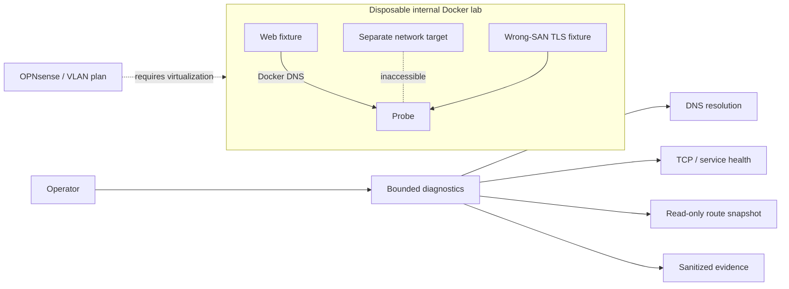

# NETSHIELD | Network Security & Incident Response Platform

**Author:** Pratik Aeraple
**Public project portal:** <https://netshield.brutehack.com>
**Repository status:** public portfolio project
**OPNsense deployment:** PLANNED / REQUIRES VIRTUALIZATION
**Production status:** this repository contains defensive tools, design artifacts and isolated lab scenarios; no BruteHost firewall or network policy is changed by these tools.

## Problem

Network incidents are easier to resolve when name resolution, routing, transport, application health and TLS identity are tested as separate layers. NETSHIELD provides reviewable network architecture and bounded diagnostics, then demonstrates selected failures inside an isolated disposable Docker lab.

## Objectives

- Define a segmented ADMIN, SERVER, APPLICATION, TESTING and MONITORING design with explicit trust boundaries.
- Capture repeatable DNS, TCP, route, health and sanitized-log evidence without changing network state.
- Demonstrate selected failure detection and recovery in internal Docker networks.
- Keep OPNsense, physical VLANs, DHCP service, VPN and production rules clearly marked as not deployed.

## Architecture



See [`docs/architecture.md`](docs/architecture.md) for the five-zone subnet/VLAN plan, routing, DNS, DHCP, VPN/management-plane design and firewall policy matrix. Example subnets use RFC 5737 TEST-NET address space and are documentation only.

## Implemented and lab-validated

- `src/diagnostics.py`: validated DNS/TCP checks with bounded timeouts, read-only route snapshot, exact-name lab-container inventory and bounded/redacted log parser.
- `policy/firewall-matrix.csv`: least-privilege example policy with default deny; **DESIGNED**, not applied.
- `lab/compose.yaml` and `lab/run.sh`: resource-limited containers on `internal: true` networks with no published ports. The repeatable lab checks DNS failure, network isolation, incorrect port, application timeout, certificate hostname mismatch, service stop and recovery.
- Tests validate input bounds, allowlisted inventory, redaction, safe read-only behavior and portal HTTP boundaries.
- `scripts/nmap-owned-lab.sh` is an optional, fixed-profile helper. It accepts only two named containers after verifying attachment to `brutehost-netshield-lab`; it has no arbitrary target or arbitrary-argument mode. Nmap is not bundled or installed.

## Designed or requiring an external platform

- **DESIGNED:** VLANs 10–50 for ADMIN/SERVER/APPLICATION/TESTING/MONITORING, inter-zone routing, firewall allow matrix, DNS resolver and DHCP scope/relay plan, VPN administration and management-plane boundaries.
- **PLANNED / REQUIRES VIRTUALIZATION:** OPNsense deployment. No OPNsense VM, physical VLAN switch, DHCP server, VPN user, routed firewall ACL or packet capture is claimed.
- Docker-internal DNS/network separation is **LAB VALIDATED**; this is not evidence of physical VLAN enforcement or an OPNsense ACL.

## Repository map

```text
docs/                 architecture, operations, incident cases
lab/                  isolated disposable Compose scenarios
policy/               designed firewall policy matrix
scripts/              constrained optional Nmap lab helper
src/                  static portal server and read-only diagnostics
tests/                HTTP and diagnostic unit tests
web/                  public portal, diagrams and metadata
```

## Run and test

Requires Python 3.11+ and Node 24.22.1 (the portal uses Node built-ins only). Optional disposable lab execution requires Docker Compose and OpenSSL; it generates a temporary self-signed test certificate and deletes only its own lab containers/networks/runtime directory.

```bash
npm run check
npm test
python3 -m unittest discover -s tests -v
./lab/run.sh
python3 src/diagnostics.py dns localhost
python3 src/diagnostics.py tcp 127.0.0.1 443 --timeout 2
```

The lab Compose project is `netshield-lab`; its two networks are internal-only and contain no route to production. The runbook refuses to replace an existing `lab/.runtime` directory. Never use broad Docker prune commands as lab cleanup.

## Security

The tools are read-only. They never invoke a shell, alter DNS/routes/firewall, scan arbitrary hosts or emit full lines that contain common secret-field labels. Nmap is restricted to owned lab containers. The portal has an exact host allowlist, strict local-only CSP, no external scripts/fonts/analytics, no application form, and no host-published Docker port. Do not put internal production IPs, credentials, packet captures or sensitive logs in public evidence.

## Troubleshooting

- `421`: confirm the exact public hostname; unapproved Host values are rejected.
- `/healthz` identity mismatch: check the immutable project revision and container health.
- A DNS failure: verify the resolver and queried name independently from TCP; do not infer routing failure from NXDOMAIN.
- A TCP timeout/refusal: keep the host, port, result and timeout separate; a failed connection does not establish why a firewall denied it.
- `lab/run.sh` refuses an existing runtime directory: inspect it manually; the script intentionally will not overwrite it.

## Lessons and future work

DNS, routing, TCP, service response and TLS name validation are separate failure domains. A single successful ping or HTTP status cannot establish end-to-end application health. The next meaningful validation needs a dedicated virtualized lab with an OPNsense console and VLAN-capable virtual switch; any physical deployment must retain an out-of-band recovery path.

## Author

Pratik Aeraple
