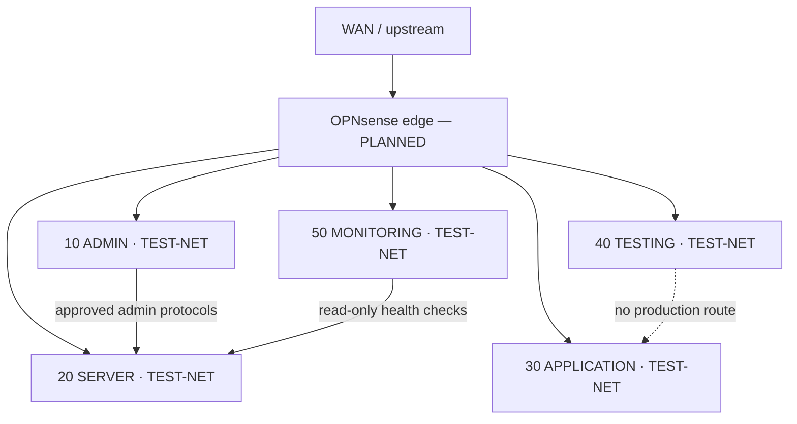

# NETSHIELD network architecture

**Status: DESIGNED.** These example ranges are documentation-only and are not deployed on BruteHost. They use RFC 5737 TEST-NET blocks so they cannot be mistaken for live host addressing.

## Segments

| VLAN | Zone | Example subnet | Purpose | Default policy |
|---:|---|---|---|---|
| 10 | ADMIN | `192.0.2.0/26` | Named admin workstations and bastion access | Deny by default; allow management to approved services |
| 20 | SERVER | `198.51.100.0/26` | DNS, DHCP and infrastructure services | Accept established; narrowly permit required service flows |
| 30 | APPLICATION | `203.0.113.0/26` | App tiers and data services | Ingress only from approved proxy/app peers |
| 40 | TESTING | `192.0.2.64/26` | Disposable test systems | No route to production; egress denied unless a drill requires it |
| 50 | MONITORING | `198.51.100.64/26` | Metrics and health probes | Read-only probes to explicit targets; no administrative ingress |

VLAN IDs and ranges are examples for a future controlled lab. Native/untagged traffic should be limited to a documented provisioning path. Inter-zone routing belongs at a stateful firewall; avoid dual-homed hosts that silently bypass it.

## Firewall policy matrix (DESIGNED)

Rules are evaluated statefully, first-match within each interface direction, with an explicit default deny and logged denials at zone boundaries. Source/destination names below are roles, not deployed addresses.

| Source | Destination | Service | Decision | Reason |
|---|---|---|---|---|
| ADMIN | approved SERVER management endpoints | SSH/HTTPS/RDP as required | Allow, named source group only | Controlled administration |
| ADMIN | APPLICATION | application HTTPS | Deny by default | Admin plane is not an application client network |
| SERVER | approved DNS upstream | UDP/TCP 53 | Allow | Resolver forwarding |
| SERVER | approved NTP upstream | UDP 123 | Allow | Time synchronization |
| APPLICATION | SERVER DNS | UDP/TCP 53 | Allow | Name resolution only |
| APPLICATION | approved data service | exact required port | Allow per application | No broad east-west access |
| TESTING | any production zone | any | Deny + log | Contain experiments |
| MONITORING | explicit service health endpoints | exact required ports | Allow, read-only | Monitoring without management access |
| any zone | any other destination | any | Deny + log | Least privilege |

## DNS, DHCP, VPN and routing (DESIGNED)

- Use one documented resolver pair per routed site; clients point only to approved recursive resolvers. Permit TCP/UDP 53 as needed and validate DNSSEC behavior separately from transport reachability.
- DHCP scopes are per VLAN with non-overlapping ranges, reservations for infrastructure, short leases in testing, and explicit options for gateway, DNS and time. DHCP relay is enabled only on routed client VLAN interfaces.
- Route only approved internal prefixes between zones. No route from TESTING to ADMIN/SERVER/APPLICATION/MONITORING. Log route changes and preserve a management recovery path before applying firewall rules.
- Remote administration design prefers managed VPN users with MFA, per-user identity, narrow address pools, time-limited access, no shared keys, and no direct WAN management. VPN deployment requires an actual OPNsense or equivalent platform and has not occurred.

## Management plane

Management endpoints should accept traffic only from named ADMIN devices or a controlled bastion, use separate administrative identities, require MFA where supported, and emit auditable events. Keep the data plane separate from management. Do not expose firewall UI, SSH, SNMP write, or hypervisor control on WAN. Change examples require a saved configuration and a tested rollback path.

## OPNsense deployment state

**OPNsense deployment: PLANNED / REQUIRES VIRTUALIZATION.** No OPNsense VM, physical VLAN switch, VPN user, or live firewall rule is claimed. Implement the design only on an isolated lab host with a console recovery path.
